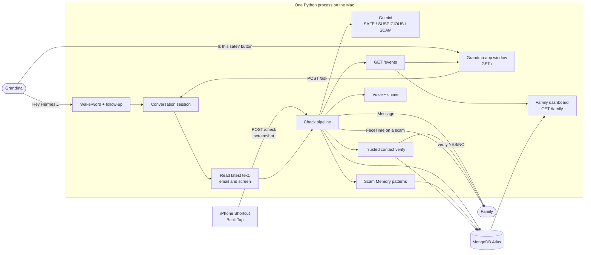

<p align="center"></p>

# Hermes

**A calm AI scam guard for grandparents.** Built at HackUTA 2026 (theme: *Odyssey*).

In the Odyssey, **Hermes** gives Odysseus a small white flower called moly. With it, Circe's
trick cannot fool him. Hermes is that messenger for Grandma: he looks at the message first, so the
trick doesn't work.

- **On the Mac:** Grandma says *"Hey Hermes, I just received a text, can you clarify it for me?"*
  Hermes reads her latest text, her latest email and her screen, decides which one she means,
  and tells her out loud whether it is **safe**, **suspicious** or a **scam**.
- **Conversational:** Hermes asks follow-ups when context is thin, explains *why* something is
  dangerous, can call a trusted contact ("Hermes, call my daughter"), and keeps a short session
  history — without re-sending the whole chat to Gemini every turn.
- **Trusted contact verification:** on possible impersonation ("I'm your grandson… send money"),
  Hermes can ask Grandma to verify with a pre-approved family member over a known channel. An
  optional family verification phrase can be required. Voice match is never treated as proof.
- **Scam Memory:** suspicious senders, numbers, domains and payment asks are remembered across
  days. When a new message links to an earlier incident, Hermes warns about the pattern.
- **On the iPhone:** a Back Tap runs an Apple Shortcut that sends a screenshot to Hermes and
  speaks the answer.
- **For the family:** every check is saved to the dashboard. The family gets an iMessage only
  when it matters: an alert for a scam, a check-in for something suspicious, or a note when
  Hermes could not check. Safe messages stay quiet. A scam on the Mac also opens FaceTime to
  the family (unless a verification offer is in progress).
- **Hermes never replies to, deletes or clicks anything for her.** It only explains and alerts.

## Accounts and the background guard

**Sign in first.** On first launch the window opens on a sign-up screen: first and last
name, phone number, date of birth, emergency contact and a password, then a consent and
privacy screen. No verification code is sent. *Forgot password* asks for the phone number
and the date of birth on the account, then a new password; the person then signs in with
it (a reset never signs anyone in by itself). Anyone 18 or younger, or 50 or older, must
add an emergency contact; for everyone else it is optional. Each account (name,
phone, date of birth, emergency contact, password hash) is a document in the MongoDB `users`
collection, so nothing about a person is set in `.env` and the same account works from any
Mac. Only "who is signed in on this Mac" is kept locally (`data/session.json`, not
committed). Every saved check is tagged with its user, and the dashboard shows only that
user's checks.

**Then nobody has to call Hermes.** While signed in and after consent, `watcher.py` checks
who sent each new incoming text against Contacts before fetching any content. Messages from
saved contacts are never read, and if Contacts cannot be read the guard pauses. For any other number, ordinary chat is ignored
silently, and that number stays watched until it is saved in Contacts. When a message
mentions prizes, bank or card details, SSN, codes, payments or an odd link, Hermes checks it,
and if it is suspicious or a scam the window pops up, Hermes says so out loud, and the
emergency contact gets an iMessage. The wake word and the swipe still work as before.

## iPhone and the web (hosted)

iPhones do not let any app read incoming texts, so the silent guard exists only in the Mac
app. On an iPhone, Hermes is a web app: open the site in Safari, sign in with the same
account, swipe, then add a screenshot or paste the message. The verdict appears and is
spoken. If it is suspicious or a scam and the account has an emergency contact, a
"Tell <name> about this" button opens Messages with a ready text for the person to send.
Use Share → Add to Home Screen for an app icon.

`server.py` is that hosted version: accounts, per-browser sign-in (a cookie, stored in
MongoDB) and `POST /api/check`. It has no Mac-only parts. To run it locally:

```bash
.venv/bin/python -m uvicorn server:app --port 8001
```

**Putting it online (free) with a GoDaddy domain**

1. Create a free account at https://render.com and choose New → Blueprint, then pick this
   GitHub repository. `render.yaml` describes the service.
2. When asked, paste `GEMINI_API_KEY` and `MONGODB_URI` (the same values as in `.env`).
3. In MongoDB Atlas → Network Access, allow access from anywhere (`0.0.0.0/0`).
4. In Render → the service → Settings → Custom Domains, add the domain. Render shows the
   DNS records to create.
5. In GoDaddy → the domain → DNS, add those records. HTTPS is set up automatically.

The free plan sleeps after 15 minutes without visitors and takes about a minute to wake.

## Tests

```bash
.venv/bin/python -m unittest discover -s tests -t .
```

- `tests/test_auth_unit.py`: account rules, sign-in, forgotten password.
- `tests/test_guard_unit.py`: the background guard and the verdict safety net.
- `tests/test_web_integration.py`: the hosted site over real HTTP requests.
- `tests/test_mac_integration.py`: the Mac app's own routes.

The tests never touch the real database, send messages, or call Gemini.

## How it works



| File | What it does |
|---|---|
| `app.py` | FastAPI server, the native window, startup |
| `checker.py` | The one check pipeline: Gemini, speaking-style guard, MongoDB, family message |
| `conversation.py` | Interactive turns: session ID, small history window, intents (check / why / call / verify) |
| `memory.py` | Scam Memory: normalize senders/domains, MongoDB match, Gemini-assisted pattern notes |
| `verify.py` | Trusted-contact verification for impersonation (iMessage + optional family phrase) |
| `server.py` | The hosted web version for iPhone and browsers (no Mac-only parts) |
| `auth.py` | Accounts: sign-up, sign-in, password reset, consent, emergency contact |
| `watcher.py` | Background guard for new texts from numbers not saved in Contacts |
| `mac.py` | Reads the latest text (`chat.db`, read-only), latest email, screenshot; iMessage; FaceTime |
| `listener.py` | Wake-word listener + short follow-up window after each answer |
| `voice.py` | Hermes's voice: cached wake-up line, chime, cloud voices, Mac fallback |
| `config.py` | Every setting, loaded from `.env`. The product name is `APP_NAME` (default `Hermes`); wake words follow it, or set `WAKE_WORDS`. |
| `doctor.py` | Health check: shows what Hermes can and cannot read |
| `static/` | Grandma UI (`index.html`), family dashboard (`family.html`), icons |

## Setup (about 10 minutes, all free)

Needs macOS with Python 3.9 or newer. No Homebrew required.

```bash
cd ~/trojan    # the folder keeps its original name
python3 -m venv .venv
.venv/bin/pip install -r requirements.txt
cp .env.example .env
```

Fill in `.env`:

| Setting | Where to get it |
|---|---|
| `GEMINI_API_KEY` | Free key from https://aistudio.google.com/apikey |
| `MONGODB_URI` | Free M0 cluster at https://cloud.mongodb.com → Connect → Drivers. Allow access from anywhere (`0.0.0.0/0`) under Network Access. |
| `TRUSTED_CONTACTS` | Optional extras: `Maya:+12145550123,Sam:+12145550199` |
| `VERIFY_PHRASE` | Optional private family phrase for verification replies |
| `SCAM_MEMORY_DAYS` | How far back pattern matching looks (default `14`) |

## Permissions

Grant these to the app you launch Hermes from (Terminal), in **System Settings → Privacy &
Security**, then quit and reopen Terminal:

| Permission | Why |
|---|---|
| Full Disk Access | Read the latest text from `~/Library/Messages/chat.db` (read-only) |
| Screen & System Audio Recording | Take the screenshot |
| Microphone | Hear "Hey Hermes" |
| Automation → Messages | Send the family iMessage (prompt appears on first use) |
| Automation → Mail | Read the latest email (prompt appears on first use; keep Mail open) |

Check them any time:

```bash
.venv/bin/python doctor.py
```

## Run

```bash
.venv/bin/python app.py
```

Or double-click **`Hermes.command`**.

Hermes works like "Hey Siri": it waits in the background with no window and no Dock icon.
Say **"Hey Hermes"** and the window appears in front of everything, reviews the screen, and
answers. About 20 seconds after answering it tucks itself away again. Closing the window
only hides it; press Ctrl+C in the terminal to quit.

To have it ready after every login, add `Hermes.command` under **System Settings → General →
Login Items**.

- Family dashboard: http://localhost:8000/family
- Flags: `--show` (keep the window on screen, with swipe-to-check),
  `--no-window` (browser only), `--no-mic` (swipe only).
- Preview any UI state without a real check: `http://localhost:8000/?demo=scam`
  (also `safe`, `suspicious`, `thinking`, `listening`).

## Voice

Hermes picks the best voice available and never stays silent:

1. **Fish Audio** if `FISH_API_KEY` is set (same TTS as Cal Hacks 12.0 FaceTimeOS) — recommended
2. **ElevenLabs** if `ELEVENLABS_API_KEY` is set
3. **Gemini's natural voice** (default; free, uses the same `GEMINI_API_KEY`). Default voice is
   `Kore` (clear). Others: `Aoede`, `Sulafat`, `Achernar`. Set `GEMINI_VOICE=off` for Mac only.
4. **macOS `say`** as the instant fallback if anything above fails.

Free Fish key: https://fish.audio/app/api-keys/ — add `FISH_API_KEY=` to `.env` and restart.

To make the Mac fallback sound good, download a premium voice: **System Settings →
Accessibility → Spoken Content → System Voice → Manage Voices**, then pick *Premium* /
*Enhanced* (Zoe, Nora, Samantha). Rate is `TROJAN_RATE` (155).

How Hermes speaks: two short lines only — the answer, then what to do. No long “what it isn’t”
explanations. *"I'm here."* is cached and plays instantly. A soft chime plays before a scam
warning.

## iPhone Shortcut

The iPhone and the Mac must be on the same network (a phone hotspot works if venue Wi-Fi
blocks device-to-device traffic). Use the `iPhone URL` printed when Hermes starts.

1. Shortcuts app → **+** → name it **Hermes**.
2. Add **Take Screenshot**.
3. Add **Base64 Encode** (input: Screenshot, Line Breaks: None).
4. Add **Get Contents of URL**: URL `http://<Mac IP>:8000/check`, Method **POST**,
   Request Body **JSON** with `device` = `iphone`, `question` = `Is this safe?`,
   `image_b64` = *Base64 Encoded*.
5. Add **Get Dictionary Value**: key `speech`.
6. Add **Speak Text**.
7. Settings → Accessibility → Touch → **Back Tap** → Double Tap → **Hermes**.

Home-screen icon: share menu → **Add to Home Screen** → tap the icon → **Choose Photo** →
`static/icons/icon-ios-1024.png` (AirDrop it to the phone first).

## API

`POST /check`

```json
{ "device": "iphone", "question": "Is this safe?", "text": null, "email": null, "image_b64": "..." }
```

Response (always includes `verdict` and `speech`):

```json
{
  "verdict": "SCAM",
  "speech": "This text is a scam. The post office never asks for money by text. Please don't tap anything in it.",
  "item": "text", "sender": "+1 555 0100",
  "headline": "This text is a scam.", "reason": "…", "action": "…", "device": "iphone"
}
```

Other routes: `GET /` (Grandma UI), `GET /family` (dashboard), `GET /events` (Server-Sent
Events: `idle`, `listening`, `thinking`, `safe`, `suspicious`, `scam`), `GET /api/checks`
(history as JSON), `POST /converse` (local conversational turn), `GET /api/patterns`
(Scam Memory), `GET /api/contacts`, `POST /api/verify/start`, `POST /api/verify`
(family yes/no), `GET /api/verify/pending`.

## Demo script (2 minutes)

1. **Hook (15 s).** "In the Odyssey, a small white flower called moly kept Odysseus from
   being fooled by Circe. Every scam text your grandmother gets is a Circe. This is her Hermes."
2. **Mac, scam (40 s).** From another phone, text the Mac: *"USPS: your package is on hold.
   Pay $1.99 at usps-redeliver.top"*. Say: **"Hey Hermes, I just received a text, can you
   clarify it for me?"** The orb ripples, shimmers, turns coral; a soft chime; Hermes explains.
   FaceTime opens to the family.
3. **Family (20 s).** Show the iMessage alert on the family phone, then
   http://localhost:8000/family updating live.
4. **Mac, safe (20 s).** Text *"Dinner Sunday at 6? Love, Maya"*. "Hey Hermes, is this one
   okay?" The orb turns sage green. The family is not disturbed; it only appears on the dashboard.
5. **iPhone (20 s).** Open a suspicious email on the phone, double-tap the back. The phone
   speaks the verdict.
6. **Close (5 s).** "Hermes never replies, deletes or clicks. It explains, and it tells the
   people who love her."

If the room is loud, use the **Is this safe?** button instead of the wake word.

## Built with

FastAPI, Google Gemini (`google-genai`), MongoDB Atlas (`pymongo`), pywebview, SpeechRecognition,
sounddevice, and macOS's own Messages, Mail and `screencapture`.
